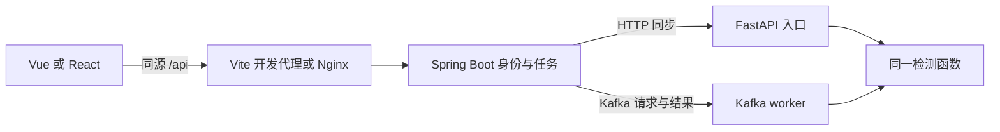

# 权限与检测接口契约



## 浏览器调用后端

| 方法和路径 | 权限 | 行为 |
| --- | --- | --- |
| `GET /api/health` | 公开 | 返回 `{"status":"UP"}` |
| `GET /api/me` | 登录 | 返回 `{username, role}` |
| `GET /api/admin/analyst` | 管理员 | 返回 `analyst` 的当前角色 |
| `PUT /api/admin/analyst` | 管理员 | 接受 JSON `{"role":"VIEWER"}` 或 `{"role":"OPERATOR"}` |
| `GET /api/detections` | 登录 | 按创建时间倒序返回最多 20 条可见任务 |
| `POST /api/detections` | 操作员、管理员 | 接受 JSON `{"sample":"sample-001"}`，返回创建的任务 |

本地演示使用 HTTP Basic。未认证返回 `401`，权限不足返回 `403`，无效输入返回 `400`。算法不可达时提交返回 `503`。样本编号最多 120 个字符。普通用户查看自己的任务，管理员查看所有任务。服务端负责校验权限与数据可见范围。

```json
{
  "id": "9edec8dc-a911-4bc0-81a9-0e43e3906ee4",
  "sample": "sample-001",
  "owner": "analyst",
  "createdAt": "2026-11-24T08:00:00Z",
  "status": "COMPLETED",
  "result": {"label":"demo","score":0.823}
}
```

### 错误响应

Spring Boot API 使用 `application/problem+json` 返回错误。`status` 与 HTTP 状态码一致，`code` 是稳定的程序判断字段，`detail` 是可公开的提示，`requestId` 与响应头 `X-Request-ID` 一致，可用于检索后端日志。

| HTTP 状态 | `code` | 场景 |
| --- | --- | --- |
| `400` | `INVALID_SAMPLE` | 样本编号为空或超出长度限制 |
| `400` | `INVALID_ROLE` | 角色不在可选范围内 |
| `400` | `INVALID_REQUEST` | 请求参数或 JSON 正文格式有误 |
| `401` | `AUTHENTICATION_REQUIRED` | 未认证或凭证无效 |
| `403` | `ACCESS_DENIED` | 当前账号无权调用接口 |
| `503` | `DETECTION_TRANSPORT_UNAVAILABLE` | 算法请求分发失败 |
| `500` | `INTERNAL_ERROR` | 服务端处理出现意外错误 |

其他由 Spring MVC 处理的状态使用 `HTTP_<状态码>`，例如 `HTTP_415`。浏览器客户端可根据 `code` 显示具体提示，其他响应按状态码处理。HTTP Basic 的 `WWW-Authenticate` 按原请求规则返回，浏览器 API 请求通过 `X-Requested-With: XMLHttpRequest` 抑制原生登录弹窗。

## 后端调用算法

- HTTP 发送 `POST /detect`，请求 `{"id":"<UUID>","sample":"sample-001"}`。算法响应 `{"id":"<UUID>","result":{"label":"demo","score":0.823}}`。后端返回 `201` 和 `COMPLETED` 任务。
- Kafka 使用相同的 UTF-8 JSON，任务主题为 `detection.jobs.v1`，结果主题为 `detection.results.v1`，消息键为任务 UUID。后端收到入队确认后返回 `202`。查询时，任务从 `PENDING` 转为 `COMPLETED`，待完成任务的 `result` 为 `null`。
- worker 发布结果后提交请求偏移。重复结果以任务 UUID 合并。演示使用单一后端实例和进程内任务记录。对跨实例部署、失败重试及长期任务，应结合业务选择持久化任务表、超时策略和死信处理。

## 文件检测接口草案

前端工作台和历史检测结果的文件版接口拟统一使用 `/api/detection-tasks`。上文的 `/api/detections` 记录当前样本编号演示的行为。下列接口用于后续接入真实数据。

| 接口 | 权限 | 请求与响应 |
| --- | --- | --- |
| `POST /api/detection-tasks` | 操作员、管理员 | 接受 JSON `{taskName, uploadId}`。原件已保存且任务登记成功后返回 `202` 和任务摘要，`Location` 指向任务状态接口。重复提交同一个 `uploadId` 返回同一任务。 |
| `GET /api/detection-tasks` | 已登录 | 历史列表和工作台最近任务共用。按创建时间倒序返回 `{items, page, pageSize, total}`，其中 `items` 为当前用户可见的任务摘要。 |
| `GET /api/detection-tasks/{taskId}` | 任务所有者、管理员 | 返回任务摘要和状态。失败时附可展示的 `failureMessage`。 |
| `GET /api/detection-tasks/{taskId}/result` | 任务所有者、管理员 | 完成后读取结果。`page`、`pageSize` 分页读取图片或检出时间点。任务尚无可预览结果时返回 `409`。 |

### 大文件上传与断点续传

典型文件为 3–4 GB，预计最大约 8 GB。每个任务关联一个图片 ZIP 或视频。单文件上限默认 **10 GiB**（10,737,418,240 字节），可按部署调整。浏览器用 `tus-js-client`，Nginx 将同源 `/api/uploads` 路由流式转发到内网 `tusd`，由 `tusd` 将字节写入原件卷的暂存区。Nginx 的单请求上限与客户端每次发送的数据量配套配置。

| 操作 | 约定 |
| --- | --- |
| `POST /api/uploads` | 操作员或管理员按 tus 协议创建上传会话。用 `Upload-Length` 声明文件总字节数，用 `Upload-Metadata` 的 `sha256` 项提交整文件摘要。该项的值按 tus 规则编码，解码后为 64 位小写十六进制字符串。响应的 `Location` 指向 `/api/uploads/{uploadId}`。 |
| `HEAD /api/uploads/{uploadId}` | 会话所有者查询服务端已接收的字节偏移、声明长度和上传元数据。 |
| `PATCH /api/uploads/{uploadId}` | 会话所有者从服务端确认的偏移继续上传。用户重选文件时，前端确认文件长度和整文件摘要一致后才继续传输。 |
| `POST /api/detection-tasks` | 文件传完后由前端自动调用。Spring Boot 校验提交权限、会话归属、已接收长度、落盘文件的 SHA-256 及基本格式，再登记任务。未传完时返回 `409`。 |

- 首次选择文件或重选文件时，浏览器在 Web Worker 中分块计算整文件的 SHA-256。后端在创建上传会话时保存声明长度和摘要。重选后对照会话信息校验，再使用 `HEAD` 返回的 `Upload-Offset` 继续传输。落盘摘要不一致时，任务登记返回可识别的校验错误，用户可重新上传。
- Nginx 在将创建、查询和续传请求交给内网 `tusd` 前，由 Spring Boot 校验登录会话和当前角色。对已有上传资源同时校验 `app_user.id` 归属，写请求同时校验 CSRF。登录过期返回 `401`，权限不足返回 `403`，跨账号访问返回 `404`。采用 `auth_request` 时，在网关显式映射跨账号访问的 `404`。上传阶段按 tus 协议返回进度和错误，任务登记使用上文的 API 错误格式。浏览器用服务端分配的 `uploadId` 登记任务，原件路径由服务端解析。
- 创建上传会话时，Spring Boot 按存储卷串行执行容量检查与预留登记。可用于新上传的空间为磁盘可用空间扣除其他活跃上传尚未写入的预留字节和配置的磁盘保留余量。空间不足时在创建阶段返回可识别的错误。上传完成或过期数据清理后释放预留，已写入的文件计入磁盘实际占用。
- 未完成的上传从最后一次传输活动起默认保留 **48 小时**。并发上传数、磁盘剩余空间阈值和 ZIP 总解压大小分别配置。算法读取 ZIP 时同时限制条目数、单项与累计解压字节数，格式或解码错误写入任务失败原因。
- 暂存区与原件区使用同一文件卷。任务登记前，将已完成且校验通过的文件以服务端生成的固定标识移入原件区，避免复制整份文件。同一会话的登记和清理互斥。事务回滚或服务重启后，重复登记可复用已落盘的原件。定期清理过期暂存文件和超期未登记的原件，回收前确认没有进行中的登记或已提交的任务引用。

### 单机存储与异步执行

首版以 Spring Boot 和算法服务同机部署为前提，通过 Docker Compose 挂载两个命名卷。

| 存储 | 职责 |
| --- | --- |
| 原件卷 | `tusd` 写入暂存区，Spring Boot 将已完成的 ZIP 或视频移入原件区。算法服务只读访问原件区，按逻辑文件标识读取。 |
| 产物卷 | 算法服务写入标注图、标注预览视频等检测产物。Spring Boot 读取产物，按下文的归属校验和短时地址规则提供预览。 |
| 数据库 | Spring Boot 保存任务归属、状态、原件与产物的逻辑标识及检出明细。算法服务通过结果协议把结果交回后端。 |

- 原件和任务记录都保存成功后，任务登记接口返回 `202 Accepted`，任务初始状态为 `PENDING`。前端按 `Location` 查询任务状态，完成后读取结果。
- 真实文件检测优先通过 Kafka 在任务登记请求之外分发，HTTP 调用 FastAPI 用于轻量联调。两种方式都传递任务 ID 和逻辑文件标识，算法从共享卷读取原件。

### 真实文件算法交接

FastAPI 和 Kafka worker 复用同一个文件检测入口。模型适配层将模型输出转换为统一的结果清单。以下字段用于真实文件检测，前文的样本演示字段见[后端调用算法](#后端调用算法)。

| 消息 | 字段与用途 |
| --- | --- |
| 任务请求 | `taskId`、`attemptId`、`type`、`originalFileId`。`type` 为 `IMAGE_ZIP` 或 `VIDEO`。算法按原件标识从共享卷读取文件。 |
| 执行开始 | `taskId`、`attemptId`。Kafka worker 开始处理时通知后端，由后端记录执行状态与截止时间。 |
| 执行成功 | `taskId`、`attemptId`、`manifestId`、`manifestVersion`、`modelVersion`。视频任务额外提供 `videoFileId`。`modelVersion` 为本次实际使用的模型版本。 |
| 执行失败 | `taskId`、`attemptId`、稳定的 `errorCode` 和可展示的 `failureMessage`。 |

算法按 `attemptId` 在产物卷保存标注媒体和结果清单，确认文件完整写入后再发送成功消息。消息通过逻辑文件标识定位文件。首版清单版本 `manifestVersion` 为 `1`，采用 UTF-8 JSON Lines，每行保存一个结果对象。

- 图片包每张处理过的图片一行，按清单顺序保存。字段为 ZIP 内相对路径 `imageName`、标注图标识 `annotatedFileId` 和 `detectionItems`。无标注预览时，`annotatedFileId` 为 `null`。无检出时保留该行，`detectionItems` 为空数组。
- 视频每个有检出的时间点一行，字段为从视频起点计算的毫秒偏移 `offsetMs` 和该时间点的 `detectionItems`。无检出的视频交付空清单和预览视频。

后端按当前执行校验清单版本、记录格式及预览文件归属，逐行读取并分批导入。只有本次执行的全部明细和预览通过校验，才按[检测结果持久化](#检测结果持久化)统一发布。重复交付同一执行的结果时复用已有导入记录。

联调覆盖图片无检出、视频空清单、缺失预览、清单解析错误和重复交付，并核对记录的模型版本。

### 任务字段与状态

- 任务摘要使用 `id`、`taskName`、`type`、`createdAt`、`status` 和 `detectionItems`。`type` 由服务端识别为 `IMAGE_ZIP` 或 `VIDEO`。`detectionItems` 是已完成结果的检出类别列表，无检出时是空数组，结果尚未生成时为 `null`。
- 初稿采用 `PENDING`（待处理）、`RUNNING`（检测中）、`COMPLETED`（已完成）、`FAILED`（失败）。前端提交后查询任务状态，完成后读取结果。HTTP 和 Kafka 的算法接入都映射到这些浏览器可见的状态。
- 历史筛选参数为 `createdFrom`、`createdTo`、`type`、`detectionItem`、`taskName`。日期范围按创建时间查询，起始包含、结束不包含，时间参数携带时区。任务名称按包含匹配。`page` 从 1 开始，`pageSize` 默认 20。服务端先按权限限制范围，再筛选和分页。

### PostgreSQL 持久化

文件检测计划使用 PostgreSQL 保存上传会话归属、任务状态、执行记录、检测结果和待发送事件。

| 表 | 职责 |
| --- | --- |
| `detection_upload` | 保存上传会话 ID、账号归属、声明长度、整文件 SHA-256，以及容量预留、任务登记和清理所需的状态。已接收的字节偏移以 `tusd` 为准。 |
| `detection_task` | 上传 ID 建唯一约束，确保一次上传最多登记一条任务。保存任务名称、提交人 ID、创建时间、类型、当前状态、原件标识、原件清理状态和已发布的执行 ID。 |
| `detection_attempt` | 一次执行对应一条记录。保存归属任务、`attemptId`、开始时间、截止时间、失败原因、实际模型版本和产物标识。一次任务可对应多次执行。 |
| `detection_result_item` | 按 `attemptId` 保存结果明细。图片包按处理过的图片保存，视频按有检出的时间点保存。 |
| `detection_task_category` | 保存任务已发布结果的类别编码。同一任务与类别编码的组合唯一，用于历史列表展示和筛选。 |
| `outbox_event` | 保存待发往 Kafka 的事件及其发送状态。首次提交和人工重试都在登记任务或更新任务状态、创建执行记录的同一个事务中写入事件。 |

Kafka 模式下，任务、首次执行记录和待发送事件在同一个事务登记。原件保存且事务提交后，任务登记接口返回 `202`。后台扫描待发送事件，收到 Kafka 发送确认后更新事件状态。后端重启后继续扫描，补发沿用同一个 `taskId` 和 `attemptId`。

历史列表以任务表为入口。操作员按提交人和创建时间查询，管理员按创建时间查询。首版索引围绕这两个查询建立，按日期、类型、检出项和任务名称筛选。检出项筛选匹配任务与类别编码的关系。结果详情按任务已发布的 `attemptId` 分页读取。

#### 检测结果持久化

- 图片 ZIP 每张处理过的图片保存一条明细，记录 ZIP 内相对路径、图片顺序和标注图引用。无命中的图片也保存一条明细，检出项为空数组。分页按已保存的图片顺序读取。
- 视频每个有检出的时间点保存一条明细，记录毫秒偏移。同一时刻的所有检出项汇总到一条记录，分页按时间点从早到晚读取。标注预览视频引用随该次执行保存。
- 图片顺序和视频时间点用普通字段保存，任务筛选使用普通字段保存的类别编码。每条明细中的检出项列表用 `JSONB` 保存，包含类别编码及置信度、框或多边形等可用标注数据。
- 后端确认明细和所需预览已保存后，在同一事务中登记已发布的 `attemptId`、更新去重后的类别摘要并将任务置为 `COMPLETED`。发布时校验当前执行仍匹配且符合回写条件。历史列表和详情读取同一次已发布执行的结果。

### 正式登录与会话

模板正式部署的默认方案为 PostgreSQL 本地账号与 Spring Security 服务端会话。企业统一登录作为按需扩展。Vue 和 React 通过同源 Cookie 使用会话，正式部署使用 HTTPS，设置 `Secure` 和 `HttpOnly` 会话 Cookie，写操作启用 CSRF 保护。上文的 HTTP Basic 接口适用于当前样本演示。

- 管理员可创建、停用账号、重置密码与分配角色。登录会话标识当前用户。后端在受保护请求中校验账号启用状态、当前角色和资源归属。
- 登录会话过期时，上传入口返回 `401`。前端暂停续传并提示重新登录。同一账号重新登录后，若上传会话仍有效且有提交权限，通过 `HEAD` 获取服务端已确认的偏移再继续。
- 角色变更从下一次授权检查生效。操作员降为查看者后，后续上传、提交和重试请求返回 `403`，仍可查看有权访问的历史结果。
- 账号停用后，已有会话的后续请求失去访问权限。已经登记的任务继续执行，管理员仍可按任务原有归属查询。媒体读取也校验当前会话及任务访问权限。

#### 首次初始化与账号管理

首次部署完成数据库迁移后，运维在服务器上运行初始化命令，交互输入首位管理员的用户名和密码，密码输入关闭回显。初始化在事务内检查管理员是否已存在，并保存账号密码哈希和管理员角色。已有管理员时，命令返回「已初始化」。

管理员创建账号时分配角色。创建账号或重置密码成功后，系统在本次响应中一次性提供随机临时密码，其有效期由部署配置。用户在有效期内登录后进入改密流程。受限会话只能读取当前用户、修改密码和退出。提交改密时再次校验临时密码有效期。改密完成后重新登录。

会话保存账号的会话版本。后端在受保护请求中校验该版本和账号当前状态。重置密码、完成改密或停用账号时递增版本，旧会话在下一次请求时失效。角色调整按当前角色授权。

初始化、停用和降权使用同一数据库事务锁串行检查管理员状态。停用或降权提交前，确认操作后仍有至少一位已启用的管理员。违反该约束时返回 `409`，管理页面显示原因。

以下为正式版接口草案。

| 接口 | 访问与行为 |
| --- | --- |
| `POST /api/auth/login` | 校验本地账号并建立会话，返回当前用户和 `mustChangePassword`。 |
| `POST /api/auth/logout` | 使当前会话失效。 |
| `GET /api/me` | 返回 `{id, username, role, mustChangePassword}`，供页面恢复登录状态及角色。 |
| `POST /api/auth/password` | 临时密码会话提交新密码，成功后进入重新登录流程。 |
| `GET /api/admin/users`、`POST /api/admin/users` | 管理员分页查询账号或创建账号并分配角色。 |
| `PATCH /api/admin/users/{userId}` | 管理员调整角色或停用账号。 |
| `POST /api/admin/users/{userId}/reset-password` | 管理员为目标账号重置临时密码。 |

联调覆盖首次初始化及重复执行、过期临时密码、临时密码会话限制、改密和重置后的旧会话失效、并发停用或降权时保留启用的管理员、同账号重登续传，以及降权或停用后的访问限制。

### 账号与权限持久化

首版采用基于角色的访问控制（RBAC）。启动后端时启用 `postgres` profile 后，现有示例接口从 PostgreSQL 读取账号和角色分配，Spring Security 和业务服务执行权限校验。

| 表 | 职责 |
| --- | --- |
| `app_user` | 保存稳定的用户 ID、唯一登录名、密码哈希和启用状态。正式登录通过追加迁移保存是否必须改密、临时密码有效期和会话版本。密码哈希由 Spring Security 的 `PasswordEncoder` 生成。 |
| `app_role` | 保存唯一角色编码和显示名称。预置 `ADMIN`（管理员）、`OPERATOR`（操作员）和 `VIEWER`（查看者）。 |
| `app_user_role` | 记录账号分配的角色。首版以 `user_id` 为主键，每个账号最多一条角色分配，创建账号时同一事务写入角色分配。 |

查看者可以查看自己的任务和结果。操作员还可以提交任务、重试自己的失败任务。管理员可以查看全部任务、提交和重试任务，并管理角色分配。首版把这些角色对应的操作写在后端权限规则里。后续需要在后台配置操作权限时，可用 `app_permission` 定义权限项，`app_role_permission` 保存角色和权限的映射。

真实文件检测接入时，`detection_task.owner_id` 引用 `app_user.id`。后端使用登录账号的用户 ID 校验任务归属，并在列表筛选和分页前限制可见范围。停用账号时保留账号记录和历史任务的归属。联调覆盖角色变更持久化、跨账号访问限制，以及修改登录名后仍能访问原有任务。

### 操作审计

正式部署后，首版审计范围限于成功的账号管理操作和人工重试。结果预览、视频播放和检出明细查询沿用访问权限校验及常规请求日志。

| 操作 | 审计详情 |
| --- | --- |
| 创建账号、停用账号、重置密码 | 目标账号 ID。 |
| 变更角色 | 目标账号 ID、变更前后的角色。 |
| 人工重试检测任务 | 任务 ID 和本次重试创建的 `attemptId`。 |

PostgreSQL 的 `audit_event` 追加保存操作时间、操作者 ID、操作类型、目标和 `requestId`，附加详情按上表的字段保存。账号变更与对应事件、重试登记与对应事件分别在同一事务提交。重复提交复用已有的重试记录时，沿用对应的审计事件。

管理后台提供仅管理员可访问的只读查询，支持按时间、操作者、操作类型和目标筛选，并按时间倒序分页。记录中的 `requestId` 可用于查询后端运行日志。

联调覆盖管理员查询、非管理员越权、角色变更前后值、重试事件去重、事务回滚和审计事件范围。

### 任务恢复与重试

- Kafka 模式下，任务在等待发送和排队期间保持 `PENDING`。worker 开始处理时通知后端，后端按实际开始时间记录 `RUNNING` 和执行截止时间。同一次执行重复收到开始通知时，沿用已记录的开始时间。HTTP 模式以后台发起算法调用为执行起点。
- 后端重启后，保留未到期的 `RUNNING` 任务并接收当前执行的结果。算法明确返回失败或执行到期时，任务进入 `FAILED`，历史列表显示失败原因。HTTP 连接断开后仍按截止时间判定，算法可能继续计算。
- 原件仍可用时，有提交权限的任务所有者或管理员可重试 `FAILED` 任务。重试沿用任务 ID 和原始文件，条件更新任务状态为 `PENDING`，同时创建具有新 `attemptId` 的执行记录。重复点击只创建一次执行。原件清理后，如需重新检测，重新上传并创建任务。
- HTTP 和 Kafka 的算法结果都携带 `taskId` 和 `attemptId`。后端只提交与当前执行编号匹配、处于 `RUNNING` 且未到期的结果。各次执行的产物按执行编号独立保存，前端读取后端已确认的产物。

联调覆盖数据库事务提交后、发送 Kafka 消息前的重启恢复，排队期间保持 `PENDING`，执行超时转失败，重复点击重试，以及旧执行的结果迟到。

### 检测数据留存

- **成功任务**随历史记录保留标注预览与检出明细。后端确认预览和检出明细已保存且任务完成状态已提交后，原件可按部署的留存配置回收。预览从产物卷读取，检出明细从持久化结果读取。
- **失败任务**在配置的重试窗口内保留原件。窗口到期后可回收原件，历史记录和失败原因继续可查。成功原件的留存时长和失败任务的重试窗口按部署确定。
- 回收只处理符合留存规则且没有在途执行读取的原件。对同一任务，清理与重试互斥。清理后记录原件状态，保留任务、检出明细和预览产物。

### 结果字段与媒体访问

- 两种结果均含 `taskId`、`type`、`items`、`page`、`pageSize` 和 `total`。`total` 按图片或检出时间点计数。图片包每项包含 `imageName`、`annotatedUrl` 和 `detectionItems`。`imageName` 对应 ZIP 内的图片相对路径。`annotatedUrl` 指向独立保存的标注图，无标注预览时为 `null`。
- 视频结果额外返回 `videoUrl`，指向独立保存的标注预览视频。每个时间点记录 `offsetMs` 和 `detectionItems`，按播放时间从早到晚返回。预览视频保持原时间轴，`offsetMs` 是从视频起点计算的毫秒数。
- 读取结果时校验任务归属并签发短时媒体地址。视频地址支持按字节范围读取，以便播放器跳转。地址到期后可重新获取结果。

格式不符或 ZIP 内容不合法时提供可展示的错误信息。支持的图片编码及视频容器和编码在接入真实数据时确认。GET 状态或结果时，越权与不存在的任务统一返回 `404`。

先实现上传服务、后端任务和媒体访问，再接入两套前端。使用代表性的 ZIP 和视频联调，其中至少一份约 8 GB。覆盖断网和服务重启后续传、同名同大小文件重选时摘要不匹配、落盘摘要不匹配、超过大小上限、上传过期、跨账号续传、写请求的 CSRF 校验、并发容量预留、并发重复登记、文件落盘后数据库事务失败、Kafka 恢复分发，以及历史筛选、结果预览和视频跳转。用约 8 GB 的样本记录首次和重选时的摘要计算耗时。回收成功任务的原件后重新打开历史详情，核对标注预览、检出明细和时间点跳转。验证失败任务原件到期后仍可查询失败原因。结果存储联调覆盖 ZIP 内同名图片、图片无检出、视频同一时刻多项检出、类别筛选和重试成功后的结果一致性。

## 每日备份与恢复

文件检测首版每日在低峰时段备份一次，备份存放在独立于业务主机的存储。部署时配置执行时间、存储位置和保留期限。整机恢复使用最近一份完整备份。

- **数据库。** 用 `pg_dump` 生成自定义格式归档，包含账号与角色、任务与执行、检出明细、审计和待派发事件等业务数据。
- **文件。** 从与数据库导出同步的快照生成文件清单，收录已发布结果引用的标注图和预览视频，以及排队、执行和仍可重试的任务所需的原件。创建快照前暂停文件回收，待清单内文件复制完毕后恢复回收。数据库归档和清单内文件都保存并校验后，才将该批次标记为完整。
- **恢复。** 在干净环境用 `pg_restore` 恢复数据库，并还原同批次文件到相应文件卷。开放任务派发前核对排队和执行中的任务、待发事件以及原件的可用状态。仅恢复备份内对应的文件，浏览器根据恢复后的状态提示用户续传或重新上传。
- **验收。** 在恢复环境验证本地账号及权限、历史筛选、检出明细、标注预览和视频时间点跳转，并核对一条待处理任务的原件与派发记录。

## 替换实现

两套前端各自在 `src/lib/http.ts` 保存同源请求逻辑，检测接口位于 `src/features/detection/api.ts`。新后端可先实现本页的响应形状、权限矩阵和任务所有权，再替换 Compose 的 `backend` 服务。两种算法传输共用 `algorithm/starter_algorithm/engine.py`，接入真实模型时先实现检测函数并定义模型输入和结果字段，再更新相关契约。
