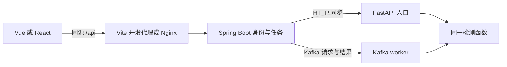

# 权限与检测接口契约



## 浏览器调用后端

| 方法和路径 | 权限 | 行为 |
| --- | --- | --- |
| `GET /api/health` | 公开 | 返回 `{"status":"UP"}` |
| `GET /api/me` | 登录 | 返回 `{username, role}` |
| `GET /api/admin/analyst` | 管理员 | 返回 `analyst` 的当前角色 |
| `PUT /api/admin/analyst` | 管理员 | 接受 JSON `{"role":"VIEWER"}` 或 `{"role":"OPERATOR"}` |
| `GET /api/detections` | 登录 | 按创建时间倒序返回最多 20 条可见任务 |
| `POST /api/detections` | 操作员、管理员 | 接受 JSON `{"sample":"sample-001"}`，返回创建的任务 |

本地演示使用 HTTP Basic。未认证返回 `401`，权限不足返回 `403`，无效输入返回 `400`。算法不可达时提交返回 `503`。样本编号最多 120 个字符。普通用户查看自己的任务，管理员查看所有任务。服务端负责校验权限与数据可见范围。

```json
{
  "id": "9edec8dc-a911-4bc0-81a9-0e43e3906ee4",
  "sample": "sample-001",
  "owner": "analyst",
  "createdAt": "2026-11-24T08:00:00Z",
  "status": "COMPLETED",
  "result": {"label":"demo","score":0.823}
}
```

### 错误响应

Spring Boot API 使用 `application/problem+json` 返回错误。`status` 与 HTTP 状态码一致，`code` 是稳定的程序判断字段，`detail` 是可公开的提示，`requestId` 与响应头 `X-Request-ID` 一致，可用于检索后端日志。

| HTTP 状态 | `code` | 场景 |
| --- | --- | --- |
| `400` | `INVALID_SAMPLE` | 样本编号为空或超出长度限制 |
| `400` | `INVALID_ROLE` | 角色不在可选范围内 |
| `400` | `INVALID_REQUEST` | 请求参数或 JSON 正文格式有误 |
| `401` | `AUTHENTICATION_REQUIRED` | 未认证或凭证无效 |
| `403` | `ACCESS_DENIED` | 当前账号无权调用接口 |
| `503` | `DETECTION_TRANSPORT_UNAVAILABLE` | 算法请求分发失败 |
| `500` | `INTERNAL_ERROR` | 服务端处理出现意外错误 |

其他由 Spring MVC 处理的状态使用 `HTTP_<状态码>`，例如 `HTTP_415`。浏览器客户端可根据 `code` 显示具体提示，其他响应按状态码处理。HTTP Basic 的 `WWW-Authenticate` 按原请求规则返回，浏览器 API 请求通过 `X-Requested-With: XMLHttpRequest` 抑制原生登录弹窗。

## 后端调用算法

- HTTP 发送 `POST /detect`，请求 `{"id":"<UUID>","sample":"sample-001"}`。算法响应 `{"id":"<UUID>","result":{"label":"demo","score":0.823}}`。后端返回 `201` 和 `COMPLETED` 任务。
- Kafka 使用相同的 UTF-8 JSON，任务主题为 `detection.jobs.v1`，结果主题为 `detection.results.v1`，消息键为任务 UUID。后端收到入队确认后返回 `202`。查询时，任务从 `PENDING` 转为 `COMPLETED`，待完成任务的 `result` 为 `null`。
- worker 发布结果后提交请求偏移。重复结果以任务 UUID 合并。演示使用单一后端实例和进程内任务记录。对跨实例部署、失败重试及长期任务，应结合业务选择持久化任务表、超时策略和死信处理。

## 替换实现

两套前端各自在 `src/lib/http.ts` 保存同源请求逻辑，检测接口位于 `src/features/detection/api.ts`。新后端可先实现本页的响应形状、权限矩阵和任务所有权，再替换 Compose 的 `backend` 服务。两种算法传输共用 `algorithm/starter_algorithm/engine.py`，接入真实模型时先实现检测函数并定义模型输入和结果字段，再更新相关契约。

文件上传、恢复、备份及数据留存的设计见[示例项目草案](../examples/ai-detection/design.md)。
